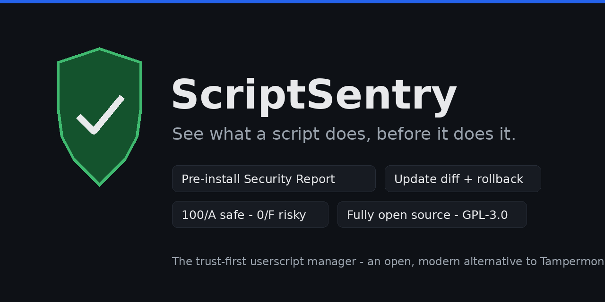

<div align="center">



# ScriptSentry

**See what a script does, before it does it.**

A trust-first, **fully open-source** userscript manager — the modern alternative to Tampermonkey.

[](LICENSE)
[](#development)
[](CHANGELOG.md)

[Preview](docs/preview/index.html) · [Roadmap](docs/roadmap.md) · [Architecture](docs/architecture.md) · [Security model](docs/security-model.md) · [Store submission](docs/store-submission.md)

</div>

---

Userscripts are powerful — and completely unvetted. A script you install today
can read your cookies, watch what you type, and phone home anywhere; an
auto-update tomorrow can quietly turn it into something else entirely. Every
existing manager shows you the raw source and wishes you luck.

**ScriptSentry is built around the three things none of them do:**

| | Tampermonkey | Violentmonkey | ScriptCat | **ScriptSentry** |
|---|:---:|:---:|:---:|:---:|
| Open source | ✗ (closed since v2.9) | ✓ MIT | ✓ GPL-3.0 | **✓ GPL-3.0** |
| Pre-install security scan + plain-English report | ✗ | ✗ | ✗ | **✓** |
| Update diff before applying + rollback | ✗ | ✗ | ✗ | **✓** |
| Version history (nothing overwritten) | ✗ | ✗ | ✗ | **✓** |
| Background / cron scripts | ✗ | ✗ | ✓ | roadmap |
| AI features | autocomplete bolt-on | ✗ | agent (testing) | roadmap (repair-first) |

## ✨ Features (v0.1.0 — Phase 0 + Phase 1)

- **🔍 Security Report (the #1 feature).** Static scan of every script before
  it runs: trust score **0–100 + grade**, plain-English capabilities ("Runs on
  EVERY website", "Can read/modify cookies"), and severity-ranked findings —
  broad `@match`, `eval`, `GM_cookie`, clipboard/download access,
  password-form reading, crypto-mining markers, obfuscation heuristics,
  `@require` without an integrity hash, fetches to undeclared domains.
- **⤺ Diff Guardian.** Paste an update and see — *before accepting it* —
  added/removed permissions, new outbound domains, new external libraries,
  size and line deltas, scanner risk delta, and a **safe / review / risky**
  verdict.
- **🕘 Version history + one-click rollback.** Every install, update, edit and
  rollback appends a revision. An update can never eat your script again.
- **📥 Migrator.** Import a Tampermonkey / Violentmonkey JSON backup or a raw
  `.user.js`, with a compatibility report flagging MV3-unsupported APIs
  (e.g. `GM_webRequest`).
- **🧭 Honest MV3 onboarding.** If Chrome's *Allow User Scripts* toggle is
  off, ScriptSentry tells you exactly that and how to fix it — instead of
  scripts silently doing nothing.
- **🌑 Modern dark dashboard + popup** with per-script trust scores.

### The scanner at both extremes (real output)

```console
$ node scripts/scan.ts examples/safe.user.js
Score: 100/100  Grade: A        # runs only on example.com, restyles the page

$ node scripts/scan.ts examples/risky.user.js
Score: 0/100  Grade: F          # eval, mining markers, cookie access,
                                # password reading, @connect *, obfuscation…
```

`examples/risky.user.js` is a **labelled test fixture — do not install it.**
It exists so the scanner (and you) have something real to catch.

## 🚀 Quick start

### Run the core + tests (no build, no dependencies)

Requires Node ≥ 22 (runs the TypeScript directly):

```bash
npm test                                   # 32 unit tests
node scripts/scan.ts examples/risky.user.js   # scan any .user.js
node scripts/scan.ts old.user.js new.user.js  # diff two versions
```

### Build the extension

```bash
npm install
npm run build          # Chrome MV3 → .output/chrome-mv3
npx wxt build -b firefox
```

Load `.output/chrome-mv3` via `chrome://extensions` → Developer mode →
*Load unpacked*, then enable **Allow User Scripts** for ScriptSentry
(Chrome 138+; the dashboard walks you through it).

## 🗺️ Roadmap — honestly labelled

Shipped: **Phase 0** foundation + **Phase 1** Trust Pack (this release).
Planned, **not** in this repo yet: Phase 2 AI Repair + X-Ray panel,
Phase 3 Git-backed library + E2E-encrypted sync + background/cron,
Phase 4 Visual Builder + verified marketplace + mobile.
Details: [docs/roadmap.md](docs/roadmap.md).

## 🏗️ Architecture

Service worker (registration sync only) + popup + dashboard over a pure,
zero-dependency TypeScript core (`metadata`, `scanner`, `diff`, `history`,
`migrator`, `match`) that is fully unit-tested outside the browser.
User code runs only via `chrome.userScripts` — the one MV3-legal route.
See [docs/architecture.md](docs/architecture.md) and
[docs/security-model.md](docs/security-model.md).

## 🤝 Contributing

PRs welcome — see [CONTRIBUTING.md](CONTRIBUTING.md). Security issues go
through [SECURITY.md](SECURITY.md), never a public issue.

## 📄 License

GPL-3.0 — see [LICENSE](LICENSE). Fully open source, no telemetry, no
closed blobs: if we ever ask for your trust, you can read the code first.
Monetisation, if it ever happens, will be hosted services around this free
manager (AI credits, hosted sync) — the manager itself stays free and open,
and BYOK / self-hosting will always work.
